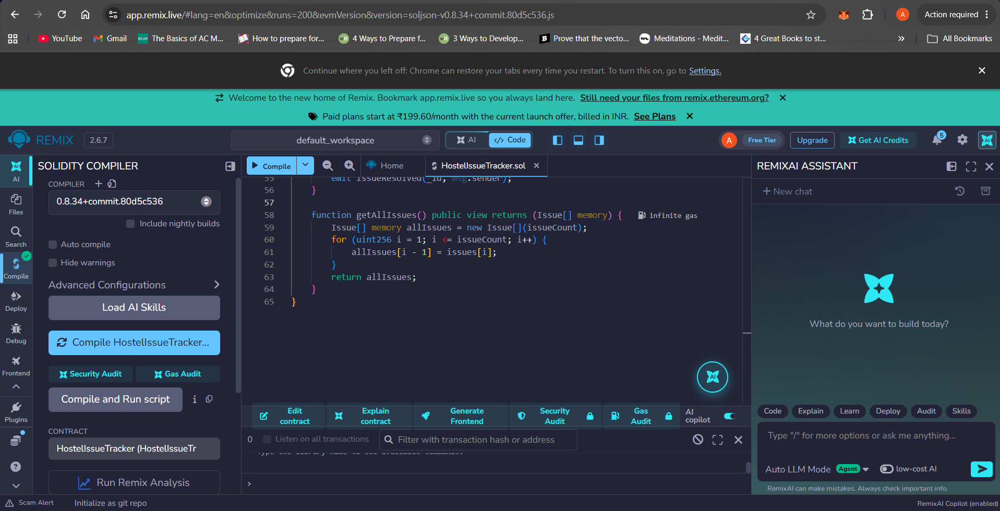
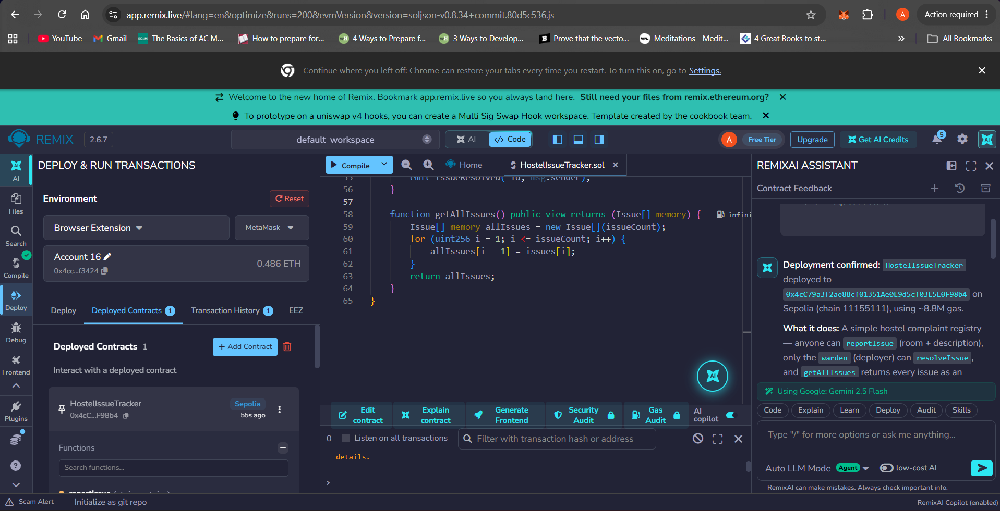
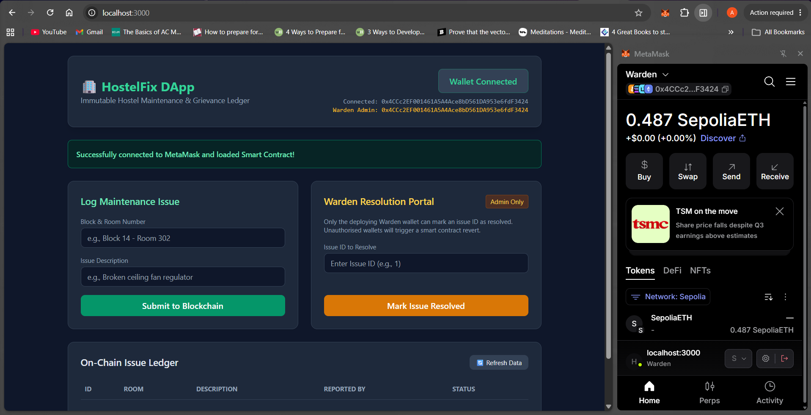
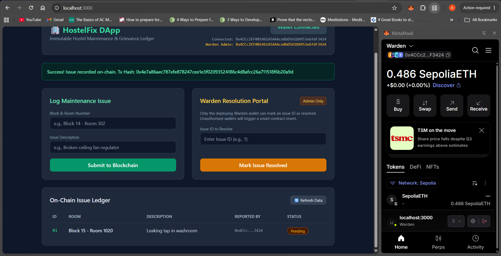
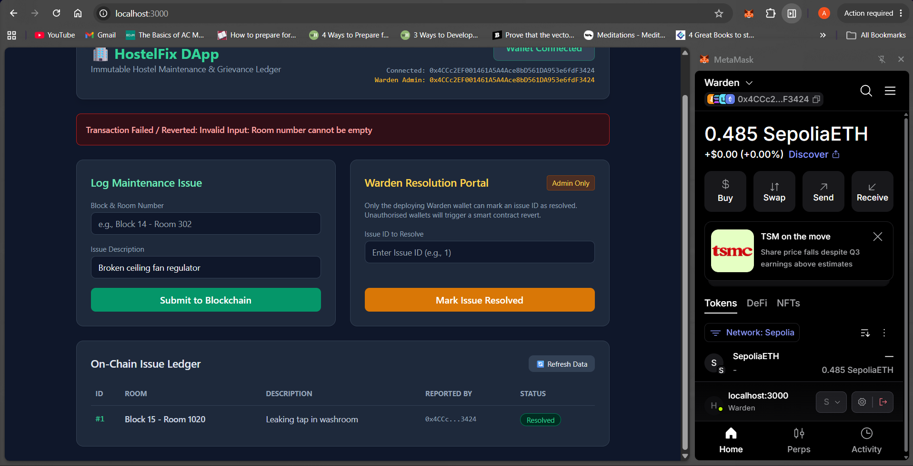
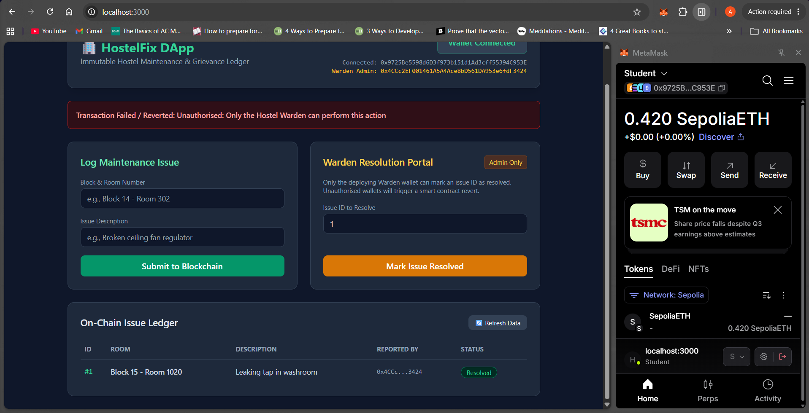
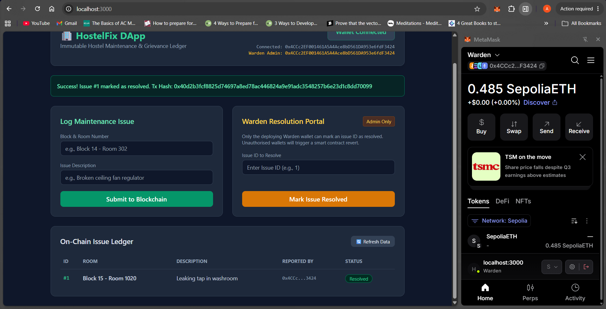

# HostelFix: Decentralized Hostel Maintenance & Issue Tracker DApp

## 1. Problem Description
In university hostels, maintenance complaints (electrical faults, plumbing, Wi-Fi issues) logged in paper registers or centralized portals are often delayed, misplaced, or prematurely marked as resolved without transparency. **HostelFix** solves this by recording maintenance tickets on the Ethereum blockchain. Every complaint is immutable and timestamped, and role-based access control ensures only the designated Hostel Warden address can mark an issue as resolved.

## 2. Deployment Details
* **Network:** Ethereum Sepolia Testnet
* **Smart Contract Name:** `HostelIssueTracker.sol`
* **Solidity Version:** `^0.8.19`
* **Deployed Contract Address:** `0x4cC79a3f2ae88cf01351Ae0E9d5cf03E5E0F98b4`

## 3. Steps to Execute the Application & Connect MetaMask
1. Clone this repository:
   ```bash
   git clone https://github.com/adityaanandbaranwal/HostelFix-DApp.git
   cd HostelFix-DApp
   ```
2. Start a local web server using Node.js:
   ```bash
   npx serve .
   ```
3. Open `http://localhost:3000` in a browser with the **MetaMask** extension installed.
4. Switch MetaMask to the **Sepolia Test Network** and click **Connect MetaMask** on the top right of the application.
5. Use the **Log Maintenance Issue** panel to submit new issues, and the **Warden Resolution Portal** (using the deployer account) to mark issues as resolved.

## 4. Test Cases (Valid, Invalid, and Unauthorised Inputs)

| Test Case ID | Test Type | Input Provided | Expected Result | Observed Result | Status |
| :--- | :--- | :--- | :--- | :--- | :--- |
| **TC-01** | **Valid Input** | Room: `"Block 14 - 302"`, Desc: `"Leaking tap"` | Transaction succeeds; `issueCount` increments to 1 and issue is stored on-chain. | MetaMask confirmed transaction; Issue #1 appeared in the UI table with `Pending` status. | PASS |
| **TC-02** | **Valid Input (Admin)** | Issue ID: `1` (Called by Warden wallet) | Transaction succeeds; Issue #1 `isResolved` status changes to `true`. | Transaction confirmed; UI badge updated from `Pending` to `Resolved`. | PASS |
| **TC-03** | **Invalid Input** | Room: `""` (Empty), Desc: `"Fan not working"` | Smart contract rejects transaction via `require()` validation. | Transaction reverted with message: `"Invalid Input: Room number cannot be empty"`. | PASS |
| **TC-04** | **Invalid Input** | Resolve Issue ID: `99` (Non-existent ID) | Smart contract rejects transaction via `require()` validation. | Transaction reverted with message: `"Invalid Input: Issue ID does not exist"`. | PASS |
| **TC-05** | **Unauthorised Input** | Resolve Issue ID: `1` (Called by non-Warden Student wallet) | `onlyWarden` modifier blocks execution and reverts transaction. | Transaction reverted with message: `"Unauthorised: Only the Hostel Warden can perform this action"`. | PASS |

## 5. Screenshots

### 1. Smart Contract Compilation


### 2. Smart Contract Deployment


### 3. MetaMask Wallet Connection


### 4. Successful Transaction


### 5. Failed / Reverted Transaction (Invalid & Unauthorised Input)



### 6. Issue Resolved and Blockchain Data Displayed in UI
